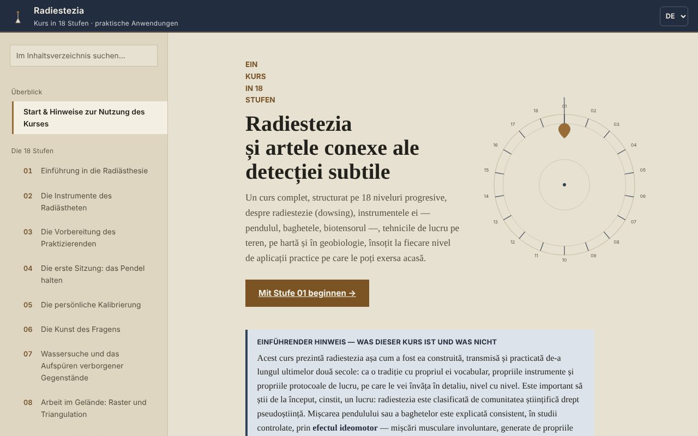

# Radiestezia — Kurs in 18 Stufen

[English](README.md) · [Română](README.ro.md) · [Français](README.fr.md) · [Italiano](README.it.md) · [Español](README.es.md) · [Português](README.pt.md) · **Deutsch** · [Magyar](README.hu.md)

**Version:** 1.2.0 · **Zuletzt aktualisiert:** 2026-10-19

Oberflächensprachen: **Română, English, Français, Italiano, Español, Português (PT), Deutsch, Magyar**

Offline-Kurs über Radiästhesie (Wünschelrute, Pendel, Geobiologie) in einer einzigen HTML-Datei, dargestellt als Tradition und Aufmerksamkeitsübung, nicht als wissenschaftlich validierte Methode.

**Online-App:** https://chiuta.github.io/Radiestezie/

## Was es ist

Ein Kurs auf Rumänisch mit 18 Stufen, dazu ein Glossar, ein Abschnitt über die wissenschaftliche Forschung, eine Methodik, ein Übungstagebuch und 9 Anhänge zum internationalen Kontext (Rumänien, Europa, Asien, Afrika, Australien und Ozeanien, Südamerika, Mittelamerika und Karibik, Nordamerika, weitere Regionen). Jede Stufe hat Theorie, eine „Praktische Anwendung“ mit Abhakliste und eine Selbstbewertung mit offenen Fragen.

Der Text sagt von Anfang an, dass die Radiästhesie von der wissenschaftlichen Gemeinschaft als Pseudowissenschaft eingestuft wird und dass kontrollierte Tests keine Ergebnisse über dem Zufall gezeigt haben. Der Kurs vermittelt die Technik und das Vokabular der Tradition sowie deren Grenzen.

## Funktionen

Im Code und im Browser geprüft:
- Navigation über 32 Abschnitte (Menü links, ☰ auf Mobilgeräten), Suche im Inhaltsverzeichnis (unabhängig von diakritischen Zeichen), Fortschrittsanzeige, direkter Link zu jedem Abschnitt (`#l5`, `#jurnal` usw.) und Unterstützung der Zurück-Schaltfläche des Browsers.
- Demonstrationstest des ideomotorischen Effekts (Stufe 1; ohne Beschleunigungssensor, zum Beispiel am Desktop, wechselt er automatisch zur Cursor-Variante): Der Beschleunigungssensor des Telefons zeichnet 8 Sekunden Mikrobewegungen der Hand auf und erstellt ein Diagramm. Er erkennt keine „Energien“.
- Sensorfreie Variante desselben Tests (Stufe 1, „Ohne Bewegungssensor“): für Desktops oder Telefone ohne zugänglichen Beschleunigungssensor; sie misst 8 Sekunden unwillkürlicher Bewegungen von Cursor oder Finger relativ zum Ausgangspunkt und stellt sie im Diagramm dar. Im Browser mit simulierten Bewegungen getestet; sie erkennt keine „Energien“.
- Auf Anfrage animierte SVG-Diagramme, „Lite“-Modus (ohne Diagramme), größere Tippflächen bei den Kontrollkästchen.
- Abhaklisten mit Fortschrittszähler (standardmäßig nur in der geöffneten Seite; optional können sie im Browser gespeichert werden, siehe unten).
- Übungstagebuch mit einer Notiz pro Stufe, als `.txt` oder `.md` herunterladbar; das optionale Kästchen „Tagebuch und Häkchen in diesem Browser behalten“ (standardmäßig aus) speichert sie unverschlüsselt in `localStorage`, und das Abwählen löscht die Kopie.
- „Zitat dieses Abschnitts kopieren“, „Erwähnte Quellen extrahieren“ (lädt eine `.txt` herunter) und eine einseitige Zusammenfassung von Stufe 14 (gesundheitliche Grenzen), herunterladbar.
- Drucken: Der angezeigte Abschnitt wird gedruckt.

## Anleitung

1. Öffne die Seite und lies den „Einführenden Hinweis“ auf der ersten Seite.
2. Wähle eine Stufe im Menü oder drücke „Stufe 01 beginnen“. Auf Mobilgeräten öffnet sich das Menü mit ☰ und schließt sich mit Esc oder durch Antippen des Hintergrunds.
3. In Stufe 1 kannst du den 8-Sekunden-Test mit dem Telefon durchführen (der Browser fragt nach der Berechtigung für den Bewegungssensor; unter iOS erscheint ein Bestätigungsfenster).
4. Führe die Übungen unter „Praktische Anwendung“ durch und hake sie ab.
5. Schreibe Notizen in „Mein Übungstagebuch“ und lade sie herunter, bevor du die Seite schließt: Standardmäßig werden sie nicht im Browser gespeichert (optional: „Tagebuch und Häkchen in diesem Browser behalten“ ankreuzen).
6. Für kritischen Kontext lies den Abschnitt „Wissenschaftliche Forschung“ und die internationalen Anhänge.

## Datenschutz und Netzwerk

- Speicher: Standardmäßig verwendet die Anwendung weder `localStorage`, `sessionStorage`, IndexedDB noch Cookies. Nur wenn du selbst „Tagebuch und Häkchen in diesem Browser behalten“ ankreuzt, werden die Notizen und Häkchen (unverschlüsselt) in `localStorage` gespeichert (Schlüssel `radiestezie.*`); das Abwählen löscht sie. Andernfalls existieren die Tagebuchnotizen und Häkchen nur, solange die Seite geöffnet ist; beim Schließen warnt der Browser, wenn nicht gespeicherte Notizen vorhanden sind.
- Netzwerk: Beim Laden wird keine externe Anfrage gestellt (im Browser geprüft). Die Sicherheitsrichtlinie der Seite (`Content-Security-Policy`, Skript per SHA-256-Hash autorisiert, ohne `'unsafe-inline'` für Skripte) blockiert jede andere externe Ressource.
- Der einzige externe Link ist die im Anhang Rumänien zitierte Digi24-Reportage; er öffnet sich nur, wenn du ihn anklickst (in einem neuen Tab, mit `noopener`).
- Berechtigungen: nur der Bewegungssensor (Beschleunigungssensor), nur wenn du „Test starten“ drückst. Es wird nichts irgendwohin gesendet.
- Die Dateien (Tagebuch, Quellen, Zusammenfassung) werden lokal im Browser erzeugt und auf dein Gerät heruntergeladen.

## Grenzen und Warnhinweise

- Die Radiästhesie hat keine wissenschaftliche Validierung. Die Bewegung von Pendel oder Ruten wird durch den ideomotorischen Effekt erklärt; kontrollierte Tests zeigen keine Ergebnisse über dem Zufall.
- Verwende sie nicht zur Diagnose, zur Wahl einer Behandlung oder einer Dosis, zur Beurteilung der Gesundheit eines Kindes oder der Sicherheit von Lebensmitteln. Rufe im Notfall die 112 an.
- Verwende sie nicht für finanzielle, rechtliche, Immobilien- oder Bauentscheidungen (Bohrungen, Grabungen, Kauf oder Renovierung einer Wohnung). Prüfe vor jeder Grabung amtlich die Lage der Versorgungsleitungen.
- Die internationalen Anhänge sind Dokumentation aus öffentlichen Online-Quellen, ohne Kontaktaufnahme mit den zitierten Organisationen (gemäß dem Methodikabschnitt der Anwendung). Preise und Kursnamen ändern sich; prüfe die Originalquellen. Einige historische Angaben (Buchtitel, Gründungsjahr einiger Vereinigungen) wurden nicht unabhängig überprüft.
- Der Beschleunigungssensor-Test hängt von Gerät und Browser ab; am Desktop funktioniert er in der Regel nicht.

## Lokale Ausführung / offline

Lade `index.html` herunter und öffne sie in einem Browser; sie hat keine externen Abhängigkeiten. Auf GitHub Pages funktioniert sie identisch.

## Verlauf / Changelog

### 1.1.0 — 2026-10-14
- Sicherungskopie und Datenkennzeichnung (fff-kit).

### 1.0.0 — 12. Oktober 2026
- Version und Datum der letzten Aktualisierung werden in der Anwendung angezeigt (Abschnitt „Methodik & letzte Prüfung“).

### 11.10.2026 (dritte Aktualisierung) — 11. Oktober 2026
- Behoben: Am Desktop tat „Test starten“ (mit Sensor) nichts Sinnvolles; fehlt der Sensor oder sendet er innerhalb von 2 Sekunden keine Daten, wechselt die Anwendung jetzt automatisch zur Cursor-/Finger-Variante, mit einer klaren Meldung.
- Tagebuch und Häkchen: optionale Speicherung im Browser (standardmäßig aus, mit dem Hinweis, dass der Speicher unverschlüsselt ist).

### 11.10.2026 (zweite Aktualisierung) — 11. Oktober 2026
- Sicherheit: CSP mit `script-src` per SHA-256-Hash, ohne `'unsafe-inline'` für Skripte.
- Stufe 1: alternativer ideomotorischer Test mit Cursor oder Finger für Geräte ohne Bewegungssensor (statt der bloßen Meldung, dass der Test am Desktop nicht funktioniert).

### 11.10.2026 — 11. Oktober 2026
- Barrierefreiheit: Der Fußzeilenhinweis ist kein in main verschachtelter contentinfo-Landmark mehr (er wird zu einer Notiz); axe-Prüfung ohne Verstöße.

## Lizenz

MIT — siehe die Datei LICENSE.

## Autor

Alexio — Alexandru-Ionuț Chiuță, Kontakt: alexio@trom.tf

## Zusammenfassung

Ein einteiliger Offline-Kurs auf Rumänisch über Radiästhesie in 18 Stufen, mit Glossar, einem Forschungsabschnitt, neun internationalen Anhängen und einem herunterladbaren Übungstagebuch. Er sagt klar, dass die Radiästhesie als Pseudowissenschaft eingestuft wird und kontrollierte Tests Ergebnisse auf Zufallsniveau zeigen, und er untersagt medizinische, finanzielle oder bauliche Entscheidungen auf dieser Grundlage. Keine externen Anfragen, keine Cookies, kein Browserspeicher; die Tagebuchnotizen existieren nur in der geöffneten Seite und können heruntergeladen werden.
