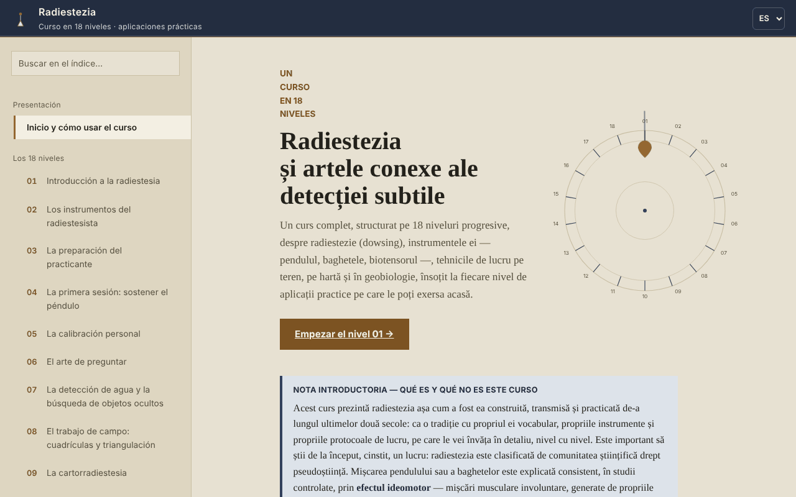

# Radiestezia — Curso en 18 niveles

[English](README.md) · [Română](README.ro.md) · [Français](README.fr.md) · [Italiano](README.it.md) · **Español** · [Português](README.pt.md) · [Deutsch](README.de.md) · [Magyar](README.hu.md)

**Versión:** 1.2.2 · **Última actualización:** 2026-10-22

Idiomas de la interfaz: **Română, English, Français, Italiano, Español, Português (PT), Deutsch, Magyar**

Curso sin conexión sobre radiestesia (péndulo, varillas, geobiología), en un único archivo HTML, presentado como tradición y ejercicio de atención, no como un método con validación científica.

**Aplicación en línea:** https://chiuta.github.io/Radiestezie/

## Qué es

Un curso en rumano, con 18 niveles, además de un glosario, una sección sobre la investigación científica, una metodología, un diario de práctica y 9 anexos de contexto internacional (Rumanía, Europa, Asia, África, Australia y Oceanía, América del Sur, América Central y el Caribe, América del Norte, otras regiones). Cada nivel tiene teoría, una «Aplicación práctica» con lista de verificación y una autoevaluación con preguntas abiertas.

El texto dice desde el principio que la comunidad científica clasifica la radiestesia como pseudociencia y que las pruebas controladas no han mostrado resultados superiores al azar. El curso enseña la técnica y el vocabulario de la tradición, junto con sus límites.

## Funciones

Comprobadas en el código y en el navegador:
- Navegación por 32 secciones (menú izquierdo, ☰ en móvil), búsqueda en el índice (insensible a los diacríticos), progreso del recorrido, enlace directo a cada sección (`#l5`, `#jurnal`, etc.) y compatibilidad con el botón Atrás del navegador.
- Prueba demostrativa del efecto ideomotor (Nivel 1; sin acelerómetro, por ejemplo en ordenador, pasa automáticamente a la variante con el cursor): el acelerómetro del teléfono registra 8 segundos de micromovimientos de la mano y dibuja un gráfico. No detecta «energías».
- Variante sin sensores de la misma prueba (Nivel 1, «Sin sensor de movimiento»): para ordenadores o teléfonos sin acelerómetro accesible, mide 8 segundos de desplazamientos involuntarios del cursor o del dedo respecto al punto de partida y los dibuja en el gráfico. Probada en el navegador con movimientos simulados; no detecta «energías».
- Diagramas SVG animados bajo demanda, modo «lite» (sin diagramas), áreas táctiles más grandes en las casillas de verificación.
- Listas de verificación con contador de progreso (por defecto solo en la página abierta; opcionalmente se pueden conservar en el navegador, véase más abajo).
- Diario de práctica con una nota por nivel, descargable como `.txt` o `.md`; la casilla opcional «Conservar el diario y las marcas en este navegador» (desactivada por defecto) los guarda en `localStorage`, sin cifrar, y al desmarcarla se borra la copia.
- «Copiar la cita de esta sección», «Extraer las fuentes mencionadas» (descarga un `.txt`) y un resumen de una pantalla del Nivel 14 (límites de salud), descargable.
- Impresión: se imprime la sección mostrada.

## Manual de uso

1. Abre la página y lee la «Nota introductoria» de la primera página.
2. Elige un nivel en el menú o pulsa «Empezar el Nivel 01». En móvil, el menú se abre con ☰ y se cierra con Esc o tocando el fondo.
3. En el Nivel 1 puedes hacer la prueba de 8 segundos con el teléfono (el navegador pide permiso para el sensor de movimiento; en iOS aparece una ventana de confirmación).
4. Haz los ejercicios de la «Aplicación práctica» y márcalos.
5. Escribe notas en «Mi diario de práctica» y descárgalas antes de cerrar la página: por defecto no se guardan en el navegador (opcionalmente, marca «Conservar el diario y las marcas en este navegador»).
6. Para un contexto crítico, lee la sección «Investigación científica» y los anexos internacionales.

## Privacidad y red

- Almacenamiento: por defecto la aplicación no usa `localStorage`, `sessionStorage`, IndexedDB ni cookies. Solo si marcas tú «Conservar el diario y las marcas en este navegador», las notas y las marcas (sin cifrar) se guardan en `localStorage` (claves `radiestezie.*`); al desmarcar se borran. En caso contrario, las notas del diario y las marcas existen solo mientras la página está abierta; al cerrar, el navegador avisa si hay notas sin guardar.
- Red: al cargar no se realiza ninguna petición externa (comprobado en el navegador). La política de seguridad de la página (`Content-Security-Policy`, script autorizado mediante hash SHA-256, sin `'unsafe-inline'` para scripts) bloquea cualquier otro recurso externo.
- El único enlace externo es el reportaje de Digi24 citado en el anexo de Rumanía; solo se abre si lo pulsas (en una pestaña nueva, con `noopener`).
- Permisos: solo el sensor de movimiento (acelerómetro), únicamente cuando pulsas «Iniciar la prueba». No se envía nada a ninguna parte.
- Los archivos (diario, fuentes, resumen) se generan localmente en el navegador y se descargan en tu dispositivo.

## Límites y advertencias

- La radiestesia no tiene validación científica. El movimiento del péndulo o de las varillas se explica por el efecto ideomotor; las pruebas controladas no muestran resultados superiores al azar.
- No la uses para diagnósticos, para elegir un tratamiento o una dosis, ni para evaluar la salud de un niño o la seguridad de los alimentos. En caso de urgencia, llama al 112.
- No la uses para decisiones financieras, jurídicas, inmobiliarias o de construcción (perforaciones, excavaciones, compra o reforma de una vivienda). Antes de cualquier excavación, comprueba oficialmente la posición de las redes de servicios.
- Los anexos internacionales son documentación a partir de fuentes públicas en línea, sin contactar con las organizaciones citadas (según la sección de metodología de la aplicación). Los precios y los nombres de los cursos cambian; comprueba las fuentes originales. Algunos datos históricos (títulos de libros, año de algunas asociaciones) no se han verificado de forma independiente.
- La prueba del acelerómetro depende del dispositivo y del navegador; en ordenador normalmente no funciona.

## Ejecución local / sin conexión

Descarga `index.html` y ábrelo en un navegador; no tiene dependencias externas. En GitHub Pages funciona igual.

## Historial / Registro de cambios

### 1.2.2 — 2026-10-22
- Un solo H1 por página (los 31 títulos de nivel ahora son H2 con el mismo aspecto); el título de la página ya no pega las palabras cuando un encabezado contiene un salto de línea; service worker y manifiesto reales (funciona sin conexión, instalable por https); confirm/prompt del navegador sustituidos por diálogos propios traducidos a los 8 idiomas; el viewport ya no limita el zoom; casillas de verificación de al menos 24 px y texto de al menos 12 px en móvil.

### 1.1.0 — 2026-10-14
- Copia de seguridad y etiquetado de datos (fff-kit).

### 1.0.0 — 12 de octubre de 2026
- La versión y la fecha de la última actualización se muestran en la aplicación (sección «Metodología y última comprobación»).

### 11.10.2026 (tercera actualización) — 11 de octubre de 2026
- Corregido: en ordenador, «Iniciar la prueba» (con sensor) no hacía nada útil; ahora, si falta el sensor o no envía datos en 2 segundos, pasa automáticamente a la variante con cursor/dedo, con un mensaje claro.
- Diario y marcas: conservación opcional en el navegador (desactivada por defecto, con la advertencia de que el almacenamiento no está cifrado).

### 11.10.2026 (segunda actualización) — 11 de octubre de 2026
- Seguridad: CSP con `script-src` sobre hash SHA-256, sin `'unsafe-inline'` para scripts.
- Nivel 1: prueba ideomotora alternativa, con el cursor o el dedo, para dispositivos sin sensor de movimiento (en lugar del simple mensaje de que la prueba no funciona en ordenador).

### 11.10.2026 — 11 de octubre de 2026
- Accesibilidad: la advertencia del pie de página ya no es un punto de referencia contentinfo anidado en main (pasa a ser una nota); comprobación axe sin infracciones.

## Licencia

MIT — véase el archivo LICENSE.

## Autor

Alexio — Alexandru-Ionuț Chiuță, contacto: alexio@trom.tf

## Resumen

Un curso sin conexión, en un único archivo y en rumano, sobre radiestesia en 18 niveles, con glosario, una sección de investigación, nueve anexos internacionales y un diario de práctica descargable. Afirma claramente que la radiestesia está clasificada como pseudociencia y que las pruebas controladas dan resultados al nivel del azar, y prohíbe tomar decisiones médicas, financieras o de construcción basadas en ella. Sin peticiones externas, sin cookies, sin almacenamiento del navegador; las notas del diario existen solo en la página abierta y se pueden descargar.
