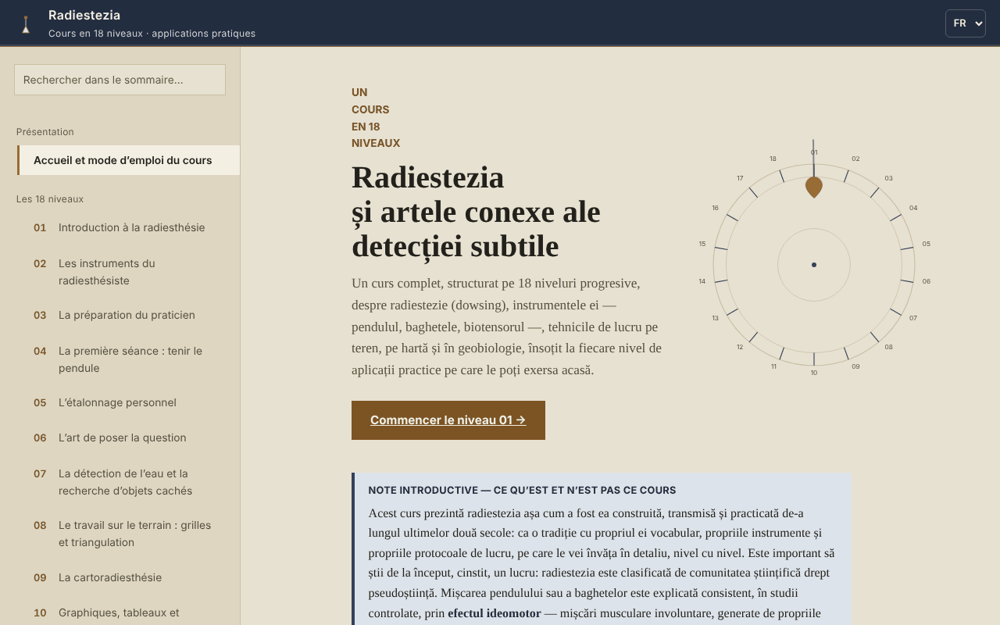

# Radiestezia — Cours en 18 niveaux

[English](README.md) · [Română](README.ro.md) · **Français** · [Italiano](README.it.md) · [Español](README.es.md) · [Português](README.pt.md) · [Deutsch](README.de.md) · [Magyar](README.hu.md)

**Version :** 1.2.6 · **Dernière mise à jour :** 2026-10-23

Langues de l'interface : **Română, English, Français, Italiano, Español, Português (PT), Deutsch, Magyar**

Cours hors ligne sur la radiesthésie (pendule, baguettes, géobiologie), dans un seul fichier HTML, présenté comme une tradition et un exercice d'attention, et non comme une méthode scientifiquement validée.

**Application en ligne :** https://chiuta.github.io/Radiestezie/

## Présentation

Un cours en roumain, en 18 niveaux, avec en plus un glossaire, une section sur la recherche scientifique, une méthodologie, un journal de pratique et 9 annexes de contexte international (Roumanie, Europe, Asie, Afrique, Australie et Océanie, Amérique du Sud, Amérique centrale et Caraïbes, Amérique du Nord, autres régions). Chaque niveau comporte de la théorie, une « Application pratique » avec liste à cocher et une auto-évaluation avec des questions ouvertes.

Le texte indique dès le départ que la radiesthésie est classée par la communauté scientifique parmi les pseudosciences et que les tests contrôlés n'ont montré aucun résultat supérieur au hasard. Le cours enseigne la technique et le vocabulaire de la tradition, ainsi que ses limites.

## Fonctionnalités

Vérifiées dans le code et dans le navigateur :
- Navigation sur 32 sections (menu de gauche, ☰ sur mobile), recherche dans la table des matières (insensible aux diacritiques), suivi de la progression, lien direct vers chaque section (`#l5`, `#jurnal`, etc.) et prise en charge du bouton Précédent du navigateur.
- Test de démonstration de l'effet idéomoteur (Niveau 1 ; sans accéléromètre, par exemple sur ordinateur, il bascule automatiquement vers la variante au curseur) : l'accéléromètre du téléphone enregistre 8 secondes de micro-mouvements de la main et trace un graphique. Il ne détecte pas d'« énergies ».
- Variante sans capteur du même test (Niveau 1, « Sans capteur de mouvement ») : pour les ordinateurs ou téléphones sans accéléromètre accessible, elle mesure 8 secondes de déplacements involontaires du curseur ou du doigt par rapport au point de départ et les trace sur le graphique. Testée dans le navigateur avec des mouvements simulés ; elle ne détecte pas d'« énergies ».
- Diagrammes SVG animés à la demande, mode « lite » (sans diagrammes), cibles tactiles plus grandes pour les cases à cocher.
- Listes à cocher avec compteur de progression (par défaut uniquement dans la page ouverte ; elles peuvent éventuellement être conservées dans le navigateur, voir ci-dessous).
- Journal de pratique avec une note par niveau, téléchargeable en `.txt` ou `.md` ; la case facultative « Conserver le journal et les coches dans ce navigateur » (désactivée par défaut) les enregistre dans `localStorage`, sans chiffrement, et la décocher supprime la copie.
- « Copier la citation de cette section », « Extraire les sources mentionnées » (télécharge un `.txt`) et un résumé d'un écran du Niveau 14 (limites pour la santé), téléchargeable.
- Impression : la section affichée est imprimée.

## Mode d'emploi

1. Ouvrez la page et lisez la « Note introductive » de la première page.
2. Choisissez un niveau dans le menu ou appuyez sur « Commencer le Niveau 01 ». Sur mobile, le menu s'ouvre avec ☰ et se ferme avec Échap ou en touchant l'arrière-plan.
3. Au Niveau 1, vous pouvez faire le test de 8 secondes avec votre téléphone (le navigateur demande l'autorisation pour le capteur de mouvement ; sur iOS, une fenêtre de confirmation apparaît).
4. Faites les exercices de l'« Application pratique » et cochez-les.
5. Écrivez des notes dans « Mon journal de pratique » et téléchargez-les avant de fermer la page : par défaut, elles ne sont pas enregistrées dans le navigateur (facultatif : cochez « Conserver le journal et les coches dans ce navigateur »).
6. Pour un contexte critique, lisez la section « Recherche scientifique » et les annexes internationales.

## Confidentialité et réseau

- Stockage : par défaut, l'application n'utilise ni `localStorage`, ni `sessionStorage`, ni IndexedDB, ni cookies. Ce n'est que si vous cochez vous-même « Conserver le journal et les coches dans ce navigateur » que les notes et les coches (non chiffrées) sont enregistrées dans `localStorage` (clés `radiestezie.*`) ; décocher les supprime. Sinon, les notes du journal et les coches n'existent que tant que la page est ouverte ; à la fermeture, le navigateur avertit s'il y a des notes non enregistrées.
- Réseau : au chargement, aucune requête externe n'est effectuée (vérifié dans le navigateur). La politique de sécurité de la page (`Content-Security-Policy`, script autorisé par hachage SHA-256, sans `'unsafe-inline'` pour les scripts) bloque toute autre ressource externe.
- Le seul lien externe est le reportage de Digi24 cité dans l'annexe Roumanie ; il ne s'ouvre que si vous cliquez dessus (dans un nouvel onglet, avec `noopener`).
- Autorisations : uniquement le capteur de mouvement (accéléromètre), seulement lorsque vous appuyez sur « Lancer le test ». Rien n'est envoyé nulle part.
- Les fichiers (journal, sources, résumé) sont générés localement dans le navigateur et téléchargés sur votre appareil.

## Limites et avertissements

- La radiesthésie n'a aucune validation scientifique. Le mouvement du pendule ou des baguettes s'explique par l'effet idéomoteur ; les tests contrôlés ne montrent aucun résultat supérieur au hasard.
- Ne l'utilisez pas pour un diagnostic, le choix d'un traitement ou d'une dose, l'évaluation de la santé d'un enfant ou de la sécurité des aliments. En cas d'urgence, appelez le 112.
- Ne l'utilisez pas pour des décisions financières, juridiques, immobilières ou de construction (forages, fouilles, achat ou rénovation d'un logement). Avant toute fouille, vérifiez officiellement l'emplacement des réseaux de services publics.
- Les annexes internationales sont une documentation à partir de sources publiques en ligne, sans contact avec les organisations citées (conformément à la section méthodologie de l'application). Les prix et les noms des cours changent ; vérifiez les sources originales. Certaines données historiques (titres de livres, année de création de certaines associations) n'ont pas été vérifiées de manière indépendante.
- Le test de l'accéléromètre dépend de l'appareil et du navigateur ; sur ordinateur, il ne fonctionne généralement pas.

## Exécution locale / hors ligne

Téléchargez `index.html` et ouvrez-le dans un navigateur ; il n'a aucune dépendance externe. Sur GitHub Pages, il fonctionne de la même façon.

## Historique / Journal des modifications

### 1.2.6 — 2026-10-23

- Cibles tactiles d’au moins 44 px sur les appareils tactiles (`pointer:coarse`) ; le bureau reste inchangé.

### 1.2.4 — 2026-10-22

fff-kit 1.1.4 : cibles tactiles et taille de texte minimale; cibles tactiles et texte corrigés.

### 1.2.3 — 2026-10-22
- fff-kit 1.1.2 : PBKDF2 à 600 000 itérations, protection anti-clickjacking

### 1.2.2 — 2026-10-22
- Un seul H1 par page (les 31 titres de niveau sont désormais des H2 au même aspect) ; le titre de la page ne colle plus les mots lorsqu'un intitulé contient un saut de ligne ; vrais service worker et manifeste (fonctionne hors ligne, installable via https) ; confirm/prompt du navigateur remplacés par des boîtes de dialogue propres, traduites dans les 8 langues ; le viewport ne limite plus le zoom ; cases à cocher d'au moins 24 px et texte d'au moins 12 px sur mobile.

### 1.1.0 — 2026-10-14
- Sauvegarde et étiquetage des données (fff-kit).

### 1.0.0 — 12 octobre 2026
- La version et la date de dernière mise à jour sont affichées dans l'application (section « Méthodologie et dernière vérification »).

### 11.10.2026 (troisième mise à jour) — 11 octobre 2026
- Corrigé : sur ordinateur, « Lancer le test » (avec capteur) ne faisait rien d'utile ; désormais, si le capteur est absent ou n'envoie pas de données en 2 secondes, l'application bascule automatiquement vers la variante curseur/doigt, avec un message clair.
- Journal et coches : conservation facultative dans le navigateur (désactivée par défaut, avec un avertissement indiquant que le stockage n'est pas chiffré).

### 11.10.2026 (deuxième mise à jour) — 11 octobre 2026
- Sécurité : CSP avec `script-src` sur un hachage SHA-256, sans `'unsafe-inline'` pour les scripts.
- Niveau 1 : test idéomoteur alternatif, avec le curseur ou le doigt, pour les appareils sans capteur de mouvement (au lieu du simple message indiquant que le test ne fonctionne pas sur ordinateur).

### 11.10.2026 — 11 octobre 2026
- Accessibilité : l'avertissement de pied de page n'est plus un repère contentinfo imbriqué dans main (il devient une note) ; vérification axe sans violation.

## Licence

MIT — voir le fichier LICENSE.

## Auteur

Alexio — Alexandru-Ionuț Chiuță, contact : alexio@trom.tf

## Résumé

Un cours hors ligne, en un seul fichier et en roumain, sur la radiesthésie en 18 niveaux, avec glossaire, section de recherche, neuf annexes internationales et un journal de pratique téléchargeable. Il indique clairement que la radiesthésie est classée parmi les pseudosciences et que les tests contrôlés donnent des résultats au niveau du hasard, et il interdit toute décision médicale, financière ou de construction fondée sur elle. Aucune requête externe, aucun cookie, aucun stockage du navigateur ; les notes du journal n'existent que dans la page ouverte et peuvent être téléchargées.
