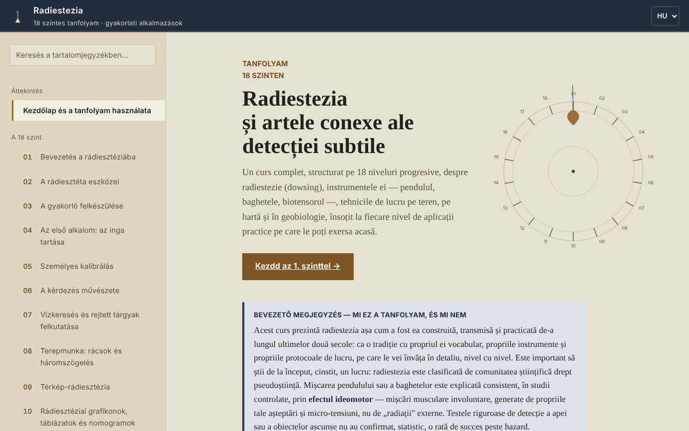

# Radiestezia — 18 szintes tanfolyam

[English](README.md) · [Română](README.ro.md) · [Français](README.fr.md) · [Italiano](README.it.md) · [Español](README.es.md) · [Português](README.pt.md) · [Deutsch](README.de.md) · **Magyar**

**Verzió:** 1.2.5 · **Utolsó frissítés:** 2026-10-23

A felület nyelvei: **Română, English, Français, Italiano, Español, Português (PT), Deutsch, Magyar**

Offline tanfolyam a sugárzásérzékelésről (radiesztézia: inga, vesszők, geobiológia) egyetlen HTML-fájlban, hagyományként és figyelemgyakorlatként bemutatva, nem tudományosan igazolt módszerként.

**Online alkalmazás:** https://chiuta.github.io/Radiestezie/

## Mi ez

Román nyelvű tanfolyam 18 szinttel, valamint szójegyzékkel, a tudományos kutatásról szóló szekcióval, módszertannal, gyakorlási naplóval és 9 nemzetközi kontextust bemutató függelékkel (Románia, Európa, Ázsia, Afrika, Ausztrália és Óceánia, Dél-Amerika, Közép-Amerika és a Karib-térség, Észak-Amerika, egyéb régiók). Minden szint tartalmaz elméletet, egy „Gyakorlati alkalmazást” pipálható listával, valamint nyílt kérdésekkel végzett önértékelést.

A szöveg már az elején kimondja, hogy a tudományos közösség a radiesztéziát áltudománynak minősíti, és hogy az ellenőrzött tesztek nem mutattak a véletlennél jobb eredményt. A tanfolyam a hagyomány technikáját és szókincsét tanítja, a korlátaival együtt.

## Funkciók

Kódban és böngészőben ellenőrizve:
- Navigáció 32 szekción át (bal oldali menü, mobilon ☰), keresés a tartalomjegyzékben (ékezetekre érzéketlen), haladáskövetés, közvetlen hivatkozás minden szekcióra (`#l5`, `#jurnal` stb.) és a böngésző Vissza gombjának támogatása.
- Az ideomotoros hatás bemutató tesztje (1. szint; gyorsulásmérő nélkül, például asztali gépen, automatikusan átvált a kurzoros változatra): a telefon gyorsulásmérője 8 másodpercig rögzíti a kéz mikromozgásait, és grafikont rajzol. Nem észlel „energiákat”.
- Ugyanennek a tesztnek az érzékelő nélküli változata (1. szint, „Mozgásérzékelő nélkül”): asztali gépekhez vagy olyan telefonokhoz, amelyeken nem érhető el gyorsulásmérő; 8 másodpercig méri a kurzor vagy az ujj akaratlan elmozdulásait a kiindulóponthoz képest, és a grafikonon ábrázolja. Böngészőben szimulált mozgásokkal tesztelve; nem észlel „energiákat”.
- Kérésre animált SVG-diagramok, „lite” mód (diagramok nélkül), nagyobb érintési célpontok a jelölőnégyzeteknél.
- Pipálható listák haladásszámlálóval (alapértelmezés szerint csak a megnyitott oldalon; opcionálisan megőrizhetők a böngészőben, lásd lent).
- Gyakorlási napló szintenként egy jegyzettel, `.txt` vagy `.md` formátumban letölthető; az opcionális „A napló és a pipák megőrzése ebben a böngészőben” jelölőnégyzet (alapértelmezés szerint kikapcsolva) titkosítatlanul menti őket a `localStorage`-ba, a jelölés törlése pedig törli a másolatot.
- „E szekció hivatkozásának másolása”, „Az említett források kivonása” (`.txt` letöltése) és a 14. szint egy képernyős összefoglalója (egészségügyi korlátok), letölthető.
- Nyomtatás: a megjelenített szekció kerül kinyomtatásra.

## Használati útmutató

1. Nyisd meg az oldalt, és olvasd el a „Bevezető megjegyzést” az első oldalon.
2. Válassz egy szintet a menüből, vagy nyomd meg a „01. szint indítása” gombot. Mobilon a menü a ☰ gombbal nyílik, és Esc-pel vagy a háttér megérintésével zárható.
3. Az 1. szinten elvégezheted a 8 másodperces tesztet a telefonoddal (a böngésző engedélyt kér a mozgásérzékelőhöz; iOS-en megerősítő ablak jelenik meg).
4. Végezd el a „Gyakorlati alkalmazás” gyakorlatait, és pipáld ki őket.
5. Írj jegyzeteket „A gyakorlási naplóm” részben, és az oldal bezárása előtt töltsd le őket: alapértelmezés szerint nem mentődnek a böngészőben (opcionálisan jelöld be az „A napló és a pipák megőrzése ebben a böngészőben” lehetőséget).
6. Kritikai szemléletű háttérért olvasd el a „Tudományos kutatás” szekciót és a nemzetközi függelékeket.

## Adatvédelem és hálózat

- Tárolás: alapértelmezés szerint az alkalmazás nem használ `localStorage`-t, `sessionStorage`-t, IndexedDB-t vagy sütiket. Csak ha te magad bejelölöd az „A napló és a pipák megőrzése ebben a böngészőben” lehetőséget, a jegyzetek és a pipák (titkosítatlanul) a `localStorage`-ba mentődnek (`radiestezie.*` kulcsok); a jelölés törlése törli őket. Egyébként a naplójegyzetek és a pipák csak addig léteznek, amíg az oldal nyitva van; bezáráskor a böngésző figyelmeztet, ha mentetlen jegyzetek vannak.
- Hálózat: betöltéskor nem történik külső kérés (böngészőben ellenőrizve). Az oldal biztonsági szabályzata (`Content-Security-Policy`, SHA-256 hash-sel engedélyezett szkript, szkriptekhez `'unsafe-inline'` nélkül) minden más külső erőforrást blokkol.
- Az egyetlen külső hivatkozás a Románia-függelékben idézett Digi24-riport; csak akkor nyílik meg, ha rákattintasz (új lapon, `noopener` beállítással).
- Engedélyek: csak a mozgásérzékelő (gyorsulásmérő), kizárólag akkor, amikor a „Teszt indítása” gombot megnyomod. Semmi sem kerül elküldésre sehová.
- A fájlok (napló, források, összefoglaló) helyben, a böngészőben jönnek létre, és az eszközödre töltődnek le.

## Korlátok és figyelmeztetések

- A radiesztéziának nincs tudományos igazolása. Az inga vagy a vesszők mozgását az ideomotoros hatás magyarázza; az ellenőrzött tesztek nem mutatnak a véletlennél jobb eredményt.
- Ne használd diagnózishoz, kezelés vagy adagolás megválasztásához, gyermek egészségének vagy élelmiszerek biztonságának megítéléséhez. Vészhelyzetben hívd a 112-t.
- Ne használd pénzügyi, jogi, ingatlanügyi vagy építési döntésekhez (fúrások, ásatások, lakás vásárlása vagy felújítása). Bármilyen ásás előtt hivatalosan ellenőrizd a közművezetékek elhelyezkedését.
- A nemzetközi függelékek nyilvános online forrásokból összeállított dokumentációk, az idézett szervezetekkel való kapcsolatfelvétel nélkül (az alkalmazás módszertani szekciója szerint). Az árak és a tanfolyamnevek változnak; ellenőrizd az eredeti forrásokat. Néhány történelmi adatot (könyvcímek, egyes egyesületek alapítási éve) nem ellenőriztünk függetlenül.
- A gyorsulásmérős teszt az eszköztől és a böngészőtől függ; asztali gépen általában nem működik.

## Helyi futtatás / offline

Töltsd le az `index.html` fájlt, és nyisd meg egy böngészőben; nincsenek külső függőségei. A GitHub Pages-en azonosan működik.

## Előzmények / Változásnapló

### 1.2.4 — 2026-10-22

fff-kit 1.1.4: érintési célok és minimális szövegméret; érintési célok és szöveg javítva.

### 1.2.3 — 2026-10-22
- fff-kit 1.1.2: PBKDF2 600 000 iterációval, clickjacking elleni védelem

### 1.2.2 — 2026-10-22
- Oldalanként egyetlen H1 (a 31 szintcím mostantól H2, változatlan megjelenéssel); az oldal címe már nem ragasztja össze a szavakat, ha a címsor sortörést tartalmaz; valódi service worker és manifest (offline is működik, https-en telepíthető); a böngésző confirm/prompt ablakait saját, mind a 8 nyelvre lefordított párbeszédablakok váltják; a viewport már nem korlátozza a nagyítást; legalább 24 px-es jelölőnégyzetek és legalább 12 px-es szöveg mobilon.

### 1.1.0 — 2026-10-14
- Biztonsági mentés és adatcímkézés (fff-kit).

### 1.0.0 — 2026. október 12.
- A verzió és az utolsó frissítés dátuma megjelenik az alkalmazásban („Módszertan és utolsó ellenőrzés” szekció).

### 2026.10.11. (harmadik frissítés) — 2026. október 11.
- Javítva: asztali gépen a „Teszt indítása” (érzékelővel) nem csinált semmi hasznosat; mostantól, ha az érzékelő hiányzik vagy 2 másodpercen belül nem küld adatot, automatikusan átvált a kurzoros/ujjas változatra, egyértelmű üzenettel.
- Napló és pipák: opcionális megőrzés a böngészőben (alapértelmezés szerint kikapcsolva, figyelmeztetéssel, hogy a tárolás titkosítatlan).

### 2026.10.11. (második frissítés) — 2026. október 11.
- Biztonság: CSP a `script-src` SHA-256 hash-sel, szkriptekhez `'unsafe-inline'` nélkül.
- 1. szint: alternatív ideomotoros teszt kurzorral vagy ujjal a mozgásérzékelő nélküli eszközökhöz (az egyszerű üzenet helyett, hogy a teszt asztali gépen nem működik).

### 2026.10.11. — 2026. október 11.
- Akadálymentesség: a lábléc figyelmeztetése már nem a main elemben beágyazott contentinfo támpont (jegyzetté válik); axe-ellenőrzés szabálysértés nélkül.

## Licenc

MIT — lásd a LICENSE fájlt.

## Szerző

Alexio — Alexandru-Ionuț Chiuță, kapcsolat: alexio@trom.tf

## Összefoglaló

Egyfájlos, offline, román nyelvű tanfolyam a radiesztéziáról (sugárzásérzékelés) 18 szinten, szójegyzékkel, kutatási szekcióval, kilenc nemzetközi függelékkel és letölthető gyakorlási naplóval. Egyértelműen kimondja, hogy a radiesztézia áltudománynak minősül, és hogy az ellenőrzött tesztek véletlenszintű eredményeket mutatnak, és megtiltja az erre alapozott orvosi, pénzügyi vagy építési döntéseket. Nincsenek külső kérések, sütik vagy böngészőtárolás; a naplójegyzetek csak a megnyitott oldalon élnek, és letölthetők.
