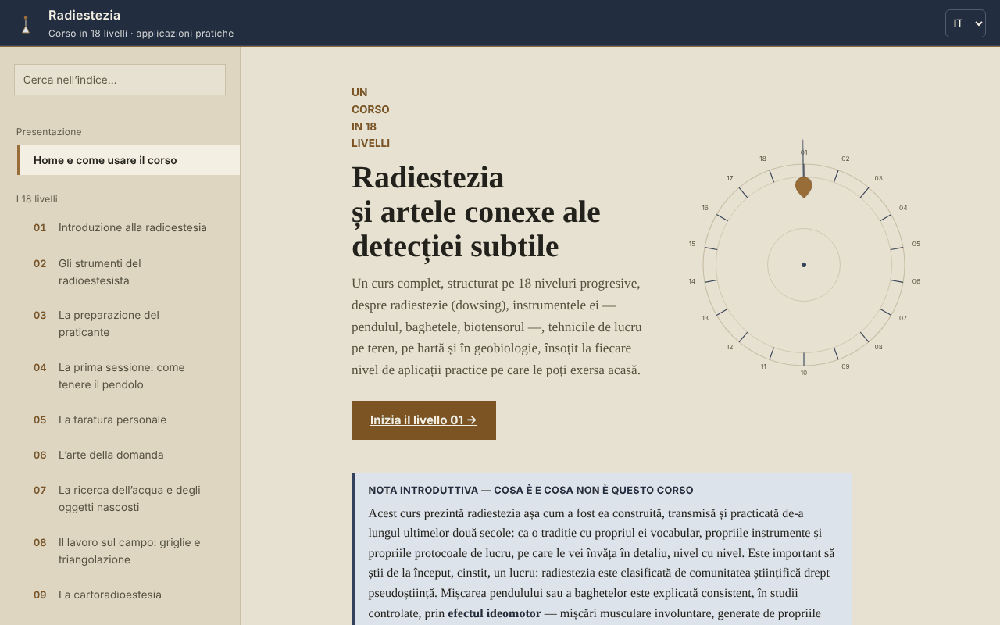

# Radiestezia — Corso in 18 livelli

[English](README.md) · [Română](README.ro.md) · [Français](README.fr.md) · **Italiano** · [Español](README.es.md) · [Português](README.pt.md) · [Deutsch](README.de.md) · [Magyar](README.hu.md)

**Versione:** 1.2.7 · **Ultimo aggiornamento:** 2026-10-26

Lingue dell'interfaccia: **Română, English, Français, Italiano, Español, Português (PT), Deutsch, Magyar**

Corso offline sulla radiestesia (pendolo, bacchette, geobiologia), in un unico file HTML, presentato come tradizione ed esercizio di attenzione, non come metodo scientificamente validato.

**App online:** https://chiuta.github.io/Radiestezie/

## Che cos'è

Un corso in lingua rumena, con 18 livelli, più un glossario, una sezione sulla ricerca scientifica, una metodologia, un diario di pratica e 9 appendici di contesto internazionale (Romania, Europa, Asia, Africa, Australia e Oceania, America del Sud, America Centrale e Caraibi, America del Nord, altre regioni). Ogni livello ha una parte teorica, un'«Applicazione pratica» con lista da spuntare e un'autovalutazione con domande aperte.

Il testo dichiara fin dall'inizio che la radiestesia è classificata dalla comunità scientifica come pseudoscienza e che i test controllati non hanno mostrato risultati superiori al caso. Il corso insegna la tecnica e il vocabolario della tradizione, insieme ai suoi limiti.

## Funzioni

Verificate nel codice e nel browser:
- Navigazione su 32 sezioni (menu a sinistra, ☰ su mobile), ricerca nell'indice (insensibile ai segni diacritici), avanzamento del percorso, link diretto a ciascuna sezione (`#l5`, `#jurnal` ecc.) e supporto del pulsante Indietro del browser.
- Test dimostrativo dell'effetto ideomotorio (Livello 1; senza accelerometro, per esempio su desktop, passa automaticamente alla variante con il cursore): l'accelerometro del telefono registra 8 secondi di micro-movimenti della mano e disegna un grafico. Non rileva «energie».
- Variante senza sensori dello stesso test (Livello 1, «Senza sensore di movimento»): per desktop o telefoni senza accelerometro accessibile, misura 8 secondi di spostamenti involontari del cursore o del dito rispetto al punto di partenza e li disegna nel grafico. Testata nel browser con movimenti simulati; non rileva «energie».
- Diagrammi SVG animati su richiesta, modalità «lite» (senza diagrammi), aree di tocco più grandi per le caselle da spuntare.
- Liste da spuntare con contatore di avanzamento (per impostazione predefinita solo nella pagina aperta; facoltativamente possono essere conservate nel browser, vedi sotto).
- Diario di pratica con una nota per livello, scaricabile come `.txt` o `.md`; la casella facoltativa «Conserva il diario e le spunte in questo browser» (disattivata per impostazione predefinita) li salva in `localStorage`, senza cifratura, e disattivandola si cancella la copia.
- «Copia la citazione di questa sezione», «Estrai le fonti menzionate» (scarica un `.txt`) e un riepilogo di una schermata del Livello 14 (limiti per la salute), scaricabile.
- Stampa: viene stampata la sezione visualizzata.

## Guida all'uso

1. Apri la pagina e leggi la «Nota introduttiva» nella prima pagina.
2. Scegli un livello dal menu o premi «Inizia il Livello 01». Su mobile, il menu si apre con ☰ e si chiude con Esc o toccando lo sfondo.
3. Al Livello 1 puoi eseguire il test di 8 secondi con il telefono (il browser chiede il permesso per il sensore di movimento; su iOS compare una finestra di conferma).
4. Svolgi gli esercizi dell'«Applicazione pratica» e spuntali.
5. Scrivi note nel «Mio diario di pratica» e scaricale prima di chiudere la pagina: per impostazione predefinita non vengono salvate nel browser (facoltativamente, spunta «Conserva il diario e le spunte in questo browser»).
6. Per un contesto critico, leggi la sezione «Ricerca scientifica» e le appendici internazionali.

## Riservatezza e rete

- Archiviazione: per impostazione predefinita l'applicazione non usa `localStorage`, `sessionStorage`, IndexedDB né cookie. Solo se spunti tu «Conserva il diario e le spunte in questo browser», le note e le spunte (non cifrate) vengono salvate in `localStorage` (chiavi `radiestezie.*`); disattivando l'opzione vengono cancellate. Altrimenti, le note del diario e le spunte esistono solo finché la pagina è aperta; alla chiusura il browser avvisa se ci sono note non salvate.
- Rete: al caricamento non viene effettuata alcuna richiesta esterna (verificato nel browser). La politica di sicurezza della pagina (`Content-Security-Policy`, script autorizzato tramite hash SHA-256, senza `'unsafe-inline'` per gli script) blocca qualsiasi altra risorsa esterna.
- L'unico link esterno è il servizio di Digi24 citato nell'appendice Romania; si apre solo se lo premi (in una nuova scheda, con `noopener`).
- Permessi: solo il sensore di movimento (accelerometro), solo quando premi «Avvia il test». Non viene inviato nulla da nessuna parte.
- I file (diario, fonti, riepilogo) vengono generati localmente nel browser e scaricati sul tuo dispositivo.

## Limiti e avvertenze

- La radiestesia non ha alcuna validazione scientifica. Il movimento del pendolo o delle bacchette è spiegato dall'effetto ideomotorio; i test controllati non mostrano risultati superiori al caso.
- Non usarla per diagnosi, per la scelta di un trattamento o di una dose, per valutare la salute di un bambino o la sicurezza degli alimenti. In caso di emergenza chiama il 112.
- Non usarla per decisioni finanziarie, legali, immobiliari o edilizie (perforazioni, scavi, acquisto o ristrutturazione di un'abitazione). Prima di qualsiasi scavo, verifica ufficialmente la posizione dei sottoservizi.
- Le appendici internazionali sono documentazione da fonti pubbliche online, senza aver contattato le organizzazioni citate (secondo la sezione di metodologia dell'applicazione). I prezzi e i nomi dei corsi cambiano; verifica le fonti originali. Alcuni dati storici (titoli di libri, anno di alcune associazioni) non sono stati verificati in modo indipendente.
- Il test dell'accelerometro dipende dal dispositivo e dal browser; su desktop di solito non funziona.

## Esecuzione locale / offline

Scarica `index.html` e aprilo in un browser; non ha dipendenze esterne. Su GitHub Pages funziona allo stesso modo.

## Cronologia / Changelog

### 1.2.6 — 2026-10-23

- Bersagli touch di almeno 44 px sui dispositivi touch (`pointer:coarse`); il desktop resta invariato.

### 1.2.4 — 2026-10-22

fff-kit 1.1.4: target touch e dimensione minima del testo; target touch e testo corretti.

### 1.2.3 — 2026-10-22
- fff-kit 1.1.2: PBKDF2 con 600.000 iterazioni, protezione anti-clickjacking

### 1.2.2 — 2026-10-22
- Un solo H1 per pagina (i 31 titoli di livello sono ora H2 con lo stesso aspetto); il titolo della pagina non incolla più le parole quando un titolo contiene un a capo; service worker e manifest reali (funziona offline, installabile via https); confirm/prompt del browser sostituiti da finestre di dialogo proprie, tradotte nelle 8 lingue; il viewport non limita più lo zoom; caselle di spunta di almeno 24 px e testo di almeno 12 px su mobile.

### 1.1.0 — 2026-10-14
- Copia di riserva ed etichettatura dei dati (fff-kit).

### 1.0.0 — 12 ottobre 2026
- La versione e la data dell'ultimo aggiornamento sono mostrate nell'applicazione (sezione «Metodologia e ultima verifica»).

### 11.10.2026 (terzo aggiornamento) — 11 ottobre 2026
- Corretto: su desktop, «Avvia il test» (con sensore) non faceva nulla di utile; ora, se il sensore manca o non invia dati entro 2 secondi, passa automaticamente alla variante con cursore/dito, con un messaggio chiaro.
- Diario e spunte: conservazione facoltativa nel browser (disattivata per impostazione predefinita, con avviso che l'archiviazione non è cifrata).

### 11.10.2026 (secondo aggiornamento) — 11 ottobre 2026
- Sicurezza: CSP con `script-src` su hash SHA-256, senza `'unsafe-inline'` per gli script.
- Livello 1: test ideomotorio alternativo, con il cursore o il dito, per i dispositivi senza sensore di movimento (invece del semplice messaggio che il test non funziona su desktop).

### 11.10.2026 — 11 ottobre 2026
- Accessibilità: l'avvertenza a piè di pagina non è più un landmark contentinfo annidato in main (diventa una nota); verifica axe senza violazioni.

## Licenza

MIT — vedi il file LICENSE.

## Autore

Alexio — Alexandru-Ionuț Chiuță, contatto: alexio@trom.tf

## Riepilogo

Un corso offline in un unico file, in lingua rumena, sulla radiestesia in 18 livelli, con glossario, una sezione di ricerca, nove appendici internazionali e un diario di pratica scaricabile. Dichiara chiaramente che la radiestesia è classificata come pseudoscienza e che i test controllati danno risultati pari al caso, e vieta decisioni mediche, finanziarie o edilizie basate su di essa. Nessuna richiesta esterna, nessun cookie, nessuna archiviazione del browser; le note del diario esistono solo nella pagina aperta e possono essere scaricate.
