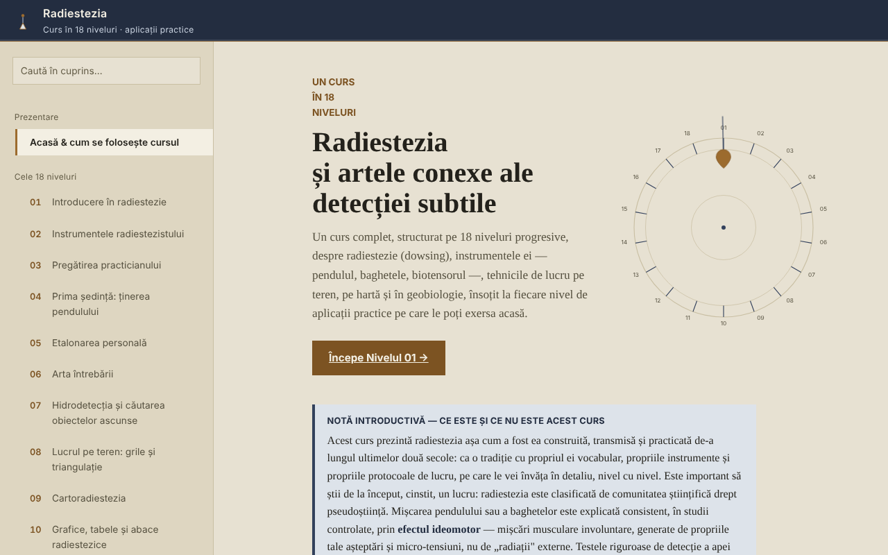

# Radiestezia — 18-level course

**English** · [Română](README.ro.md) · [Français](README.fr.md) · [Italiano](README.it.md) · [Español](README.es.md) · [Português](README.pt.md) · [Deutsch](README.de.md) · [Magyar](README.hu.md)

**Version:** 1.2.0 · **Last updated:** 2026-10-19

Interface languages: **Română, English, Français, Italiano, Español, Português (PT), Deutsch, Magyar**

An offline course on dowsing (radiesthesia: pendulum, rods, geobiology), in a single HTML file, presented as a tradition and an attention exercise, not as a scientifically validated method.

**Live app:** https://chiuta.github.io/Radiestezie/

## What it is

A course in Romanian, with 18 levels, plus a glossary, a section on scientific research, a methodology, a practice journal and 9 appendices of international context (Romania, Europe, Asia, Africa, Australia and Oceania, South America, Central America and the Caribbean, North America, other regions). Each level has theory, a "Practical application" with a checklist and a self-assessment with open questions.

The text states from the outset that dowsing is classified by the scientific community as pseudoscience and that controlled tests have shown no results above chance. The course teaches the technique and vocabulary of the tradition, together with its limits.

## Features

Verified in code and in the browser:
- Navigation across 32 sections (left-hand menu, ☰ on mobile), search in the table of contents (diacritics-insensitive), progress tracking, a direct link to each section (`#l5`, `#jurnal`, etc.) and support for the browser's Back button.
- Demonstration test of the ideomotor effect (Level 1; without an accelerometer, for example on desktop, it switches automatically to the cursor variant): the phone's accelerometer records 8 seconds of hand micro-movements and draws a graph. It does not detect "energies".
- Sensor-free variant of the same test (Level 1, "Without motion sensor"): for desktops or phones without an accessible accelerometer, it measures 8 seconds of involuntary movements of the cursor or finger relative to the starting point and plots them on the graph. Tested in the browser with simulated movements; it does not detect "energies".
- SVG diagrams animated on request, a "lite" mode (without diagrams), larger touch targets for the checkboxes.
- Checklists with a progress counter (by default only in the open page; optionally they can be kept in the browser, see below).
- Practice journal with one note per level, downloadable as `.txt` or `.md`; the optional box "Keep the journal and checkmarks in this browser" (off by default) saves them in `localStorage`, unencrypted, and unchecking it deletes the copy.
- "Copy the citation of this section", "Extract the sources mentioned" (downloads a `.txt`) and a one-screen summary of Level 14 (health limits), downloadable.
- Printing: the section on display is printed.

## User guide

1. Open the page and read the "Introductory note" on the first page.
2. Choose a level from the menu or press "Start Level 01". On mobile, the menu opens with ☰ and closes with Esc or by tapping the background.
3. At Level 1 you can do the 8-second test with your phone (the browser asks for permission for the motion sensor; on iOS a confirmation window appears).
4. Do the exercises in "Practical application" and tick them off.
5. Write notes in "My practice journal" and download them before closing the page: by default they are not saved in the browser (optionally, tick "Keep the journal and checkmarks in this browser").
6. For critical context, read the "Scientific research" section and the international appendices.

## Privacy and network

- Storage: by default the application does not use `localStorage`, `sessionStorage`, IndexedDB or cookies. Only if you yourself tick "Keep the journal and checkmarks in this browser" are the notes and checkmarks (unencrypted) saved in `localStorage` (keys `radiestezie.*`); unchecking deletes them. Otherwise, the journal notes and checkmarks exist only while the page is open; on closing, the browser warns if there are unsaved notes.
- Network: on loading, no external request is made (verified in the browser). The security policy in the page (`Content-Security-Policy`, script authorized by SHA-256 hash, no `'unsafe-inline'` for scripts) blocks any other external resource.
- The only external link is the Digi24 report cited in the Romania appendix; it opens only if you click it (in a new tab, with `noopener`).
- Permissions: only the motion sensor (accelerometer), only when you press "Start the test". Nothing is sent anywhere.
- The files (journal, sources, summary) are generated locally in the browser and downloaded to your device.

## Limits and warnings

- Dowsing has no scientific validation. The movement of the pendulum or rods is explained by the ideomotor effect; controlled tests show no results above chance.
- Do not use it for diagnosis, choosing a treatment or a dose, assessing a child's health or the safety of food. For emergencies call 112.
- Do not use it for financial, legal, real-estate or construction decisions (drilling, digging, buying or renovating a home). Before any digging, officially check the position of utility networks.
- The international appendices are documentation from public online sources, without contacting the organizations cited (according to the methodology section in the application). Prices and course names change; check the original sources. Some historical data (book titles, the year of some associations) have not been independently verified.
- The accelerometer test depends on the device and browser; on desktop it usually does not work.

## Running locally / offline

Download `index.html` and open it in a browser; it has no external dependencies. On GitHub Pages it works identically.

## History / Changelog

### 1.1.0 — 2026-10-14
- Backup and data labelling (fff-kit).

### 1.0.0 — 12 October 2026
- The version and the date of the last update are shown in the application ("Methodology & last check" section).

### 11.10.2026 (third update) — 11 October 2026
- Fixed: on desktop, "Start the test" (with sensor) did nothing useful; now, if the sensor is missing or sends no data within 2 seconds, it switches automatically to the cursor/finger variant, with a clear message.
- Journal and checkmarks: optional storage in the browser (off by default, with a warning that the storage is unencrypted).

### 11.10.2026 (second update) — 11 October 2026
- Security: CSP with `script-src` on a SHA-256 hash, without `'unsafe-inline'` for scripts.
- Level 1: alternative ideomotor test, with the cursor or finger, for devices without a motion sensor (instead of the plain message that the test does not work on desktop).

### 11.10.2026 — 11 October 2026
- Accessibility: the footer warning is no longer a contentinfo landmark nested in main (it becomes a note); axe check with no violations.

## License

MIT — see the LICENSE file.

## Author

Alexio — Alexandru-Ionuț Chiuță, contact: alexio@trom.tf

## Summary

A single-file, offline Romanian-language course on dowsing (radiesthesia) in 18 levels, with a glossary, a research section, nine international appendices and a downloadable practice journal. It states plainly that dowsing is classified as pseudoscience and that controlled tests show chance-level results, and it forbids medical, financial or construction decisions based on it. No external requests, no cookies, no browser storage; journal notes live only in the open page and can be downloaded.
