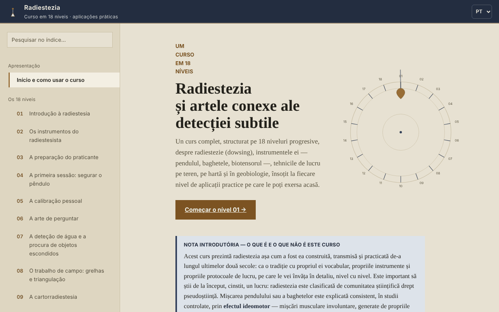

# Radiestezia — Curso em 18 níveis

[English](README.md) · [Română](README.ro.md) · [Français](README.fr.md) · [Italiano](README.it.md) · [Español](README.es.md) · **Português** · [Deutsch](README.de.md) · [Magyar](README.hu.md)

**Versão:** 2.0.3 · **Última atualização:** 2026-10-31

**Estado:** estável; estudo descritivo (sem alegações terapêuticas) · **Offline:** completo (sem pedidos de rede)

Idiomas da interface: **Română, English, Français, Italiano, Español, Português (PT), Deutsch, Magyar**

Curso offline sobre radiestesia (pêndulo, varetas, geobiologia), num único ficheiro HTML, apresentado como tradição e exercício de atenção, não como método cientificamente validado.

**Aplicação online:** https://chiuta.github.io/Radiestezie/

## O que é

Um curso em romeno, com 18 níveis, além de um glossário, uma secção sobre a investigação científica, uma metodologia, um diário de prática e 9 anexos de contexto internacional (Roménia, Europa, Ásia, África, Austrália e Oceânia, América do Sul, América Central e Caraíbas, América do Norte, outras regiões). Cada nível tem teoria, uma «Aplicação prática» com lista de verificação e uma autoavaliação com perguntas abertas.

O texto afirma desde o início que a comunidade científica classifica a radiestesia como pseudociência e que os testes controlados não mostraram resultados acima do acaso. O curso ensina a técnica e o vocabulário da tradição, juntamente com os seus limites.

## Funcionalidades

Verificadas no código e no navegador:
- Navegação por 32 secções (menu à esquerda, ☰ no telemóvel), pesquisa no índice (insensível a diacríticos), progresso do percurso, ligação direta para cada secção (`#l5`, `#jurnal`, etc.) e suporte do botão Recuar do navegador.
- Teste demonstrativo do efeito ideomotor (Nível 1; sem acelerómetro, por exemplo no computador, passa automaticamente para a variante com o cursor): o acelerómetro do telemóvel regista 8 segundos de micromovimentos da mão e desenha um gráfico. Não deteta «energias».
- Variante sem sensores do mesmo teste (Nível 1, «Sem sensor de movimento»): para computadores ou telemóveis sem acelerómetro acessível, mede 8 segundos de deslocações involuntárias do cursor ou do dedo em relação ao ponto de partida e desenha-as no gráfico. Testada no navegador com movimentos simulados; não deteta «energias».
- Diagramas SVG animados a pedido, modo «lite» (sem diagramas), áreas de toque maiores nas caixas de verificação.
- Listas de verificação com contador de progresso (por predefinição apenas na página aberta; opcionalmente podem ser guardadas no navegador, ver abaixo).
- Diário de prática com uma nota por nível, descarregável como `.txt` ou `.md`; a caixa opcional «Guardar o diário e as marcas neste navegador» (desativada por predefinição) guarda-os em `localStorage`, sem cifragem, e desmarcá-la apaga a cópia.
- «Copiar a citação desta secção», «Extrair as fontes mencionadas» (descarrega um `.txt`) e um resumo de um ecrã do Nível 14 (limites de saúde), descarregável.
- Impressão: é impressa a secção apresentada.

## Manual de utilização

1. Abra a página e leia a «Nota introdutória» da primeira página.
2. Escolha um nível no menu ou prima «Começar o Nível 01». No telemóvel, o menu abre-se com ☰ e fecha-se com Esc ou tocando no fundo.
3. No Nível 1 pode fazer o teste de 8 segundos com o telemóvel (o navegador pede permissão para o sensor de movimento; no iOS surge uma janela de confirmação).
4. Faça os exercícios da «Aplicação prática» e marque-os.
5. Escreva notas no «Meu diário de prática» e descarregue-as antes de fechar a página: por predefinição não são guardadas no navegador (opcionalmente, marque «Guardar o diário e as marcas neste navegador»).
6. Para contexto crítico, leia a secção «Investigação científica» e os anexos internacionais.

## Privacidade e rede

- Armazenamento: por predefinição a aplicação não utiliza `localStorage`, `sessionStorage`, IndexedDB nem cookies. Apenas se for você a marcar «Guardar o diário e as marcas neste navegador», as notas e as marcas (sem cifragem) são guardadas em `localStorage` (chaves `radiestezie.*`); desmarcar apaga-as. Caso contrário, as notas do diário e as marcas existem apenas enquanto a página estiver aberta; ao fechar, o navegador avisa se houver notas por guardar.
- Rede: ao carregar, não é feito nenhum pedido externo (verificado no navegador). A política de segurança da página (`Content-Security-Policy`, script autorizado por hash SHA-256, sem `'unsafe-inline'` para scripts) bloqueia qualquer outro recurso externo.
- A única ligação externa é a reportagem da Digi24 citada no anexo da Roménia; só se abre se clicar nela (num novo separador, com `noopener`).
- Permissões: apenas o sensor de movimento (acelerómetro), só quando prime «Iniciar o teste». Não é enviado nada para lado nenhum.
- Os ficheiros (diário, fontes, resumo) são gerados localmente no navegador e descarregados para o seu dispositivo.

## Limites e avisos

- A radiestesia não tem validação científica. O movimento do pêndulo ou das varetas é explicado pelo efeito ideomotor; os testes controlados não mostram resultados acima do acaso.
- Não a utilize para diagnóstico, escolha de um tratamento ou de uma dose, avaliação da saúde de uma criança ou da segurança dos alimentos. Em caso de emergência, ligue 112.
- Não a utilize para decisões financeiras, jurídicas, imobiliárias ou de construção (perfurações, escavações, compra ou remodelação de uma habitação). Antes de qualquer escavação, verifique oficialmente a posição das redes de serviços.
- Os anexos internacionais são documentação a partir de fontes públicas online, sem contacto com as organizações citadas (de acordo com a secção de metodologia da aplicação). Os preços e os nomes dos cursos mudam; verifique as fontes originais. Alguns dados históricos (títulos de livros, ano de algumas associações) não foram verificados de forma independente.
- O teste do acelerómetro depende do dispositivo e do navegador; no computador, normalmente não funciona.

## Execução local / offline

Descarregue `index.html` e abra-o num navegador; não tem dependências externas. No GitHub Pages funciona da mesma forma.

## Histórico / Registo de alterações

### 1.2.6 — 2026-10-23

- Alvos de toque de pelo menos 44 px em dispositivos táteis (`pointer:coarse`); o computador não muda.

### 1.2.4 — 2026-10-22

fff-kit 1.1.4: alvos de toque e tamanho mínimo do texto; alvos de toque e texto corrigidos.

### 1.2.3 — 2026-10-22
- fff-kit 1.1.2: PBKDF2 com 600.000 iterações, proteção anti-clickjacking

### 1.2.2 — 2026-10-22
- Um único H1 por página (os 31 títulos de nível são agora H2 com o mesmo aspeto); o título da página já não cola as palavras quando um cabeçalho contém uma quebra de linha; service worker e manifesto reais (funciona offline, instalável por https); confirm/prompt do navegador substituídos por diálogos próprios traduzidos nos 8 idiomas; o viewport já não limita o zoom; caixas de seleção de pelo menos 24 px e texto de pelo menos 12 px no telemóvel.

### 1.1.0 — 2026-10-14
- Cópia de segurança e etiquetagem de dados (fff-kit).

### 1.0.0 — 12 de outubro de 2026
- A versão e a data da última atualização são mostradas na aplicação (secção «Metodologia e última verificação»).

### 11.10.2026 (terceira atualização) — 11 de outubro de 2026
- Corrigido: no computador, «Iniciar o teste» (com sensor) não fazia nada de útil; agora, se o sensor não existir ou não enviar dados em 2 segundos, passa automaticamente para a variante com cursor/dedo, com uma mensagem clara.
- Diário e marcas: conservação opcional no navegador (desativada por predefinição, com aviso de que o armazenamento não é cifrado).

### 11.10.2026 (segunda atualização) — 11 de outubro de 2026
- Segurança: CSP com `script-src` por hash SHA-256, sem `'unsafe-inline'` para scripts.
- Nível 1: teste ideomotor alternativo, com o cursor ou o dedo, para dispositivos sem sensor de movimento (em vez da simples mensagem de que o teste não funciona no computador).

### 11.10.2026 — 11 de outubro de 2026
- Acessibilidade: o aviso do rodapé deixa de ser um marco contentinfo aninhado em main (passa a ser uma nota); verificação axe sem violações.

## Licença

MIT — veja o ficheiro LICENSE.

## Autor

Alexio — Alexandru-Ionuț Chiuță, contacto: alexio@trom.tf

## Resumo

Um curso offline, num único ficheiro e em romeno, sobre radiestesia em 18 níveis, com glossário, uma secção de investigação, nove anexos internacionais e um diário de prática descarregável. Afirma claramente que a radiestesia está classificada como pseudociência e que os testes controlados dão resultados ao nível do acaso, e proíbe decisões médicas, financeiras ou de construção baseadas nela. Sem pedidos externos, sem cookies, sem armazenamento do navegador; as notas do diário existem apenas na página aberta e podem ser descarregadas.
